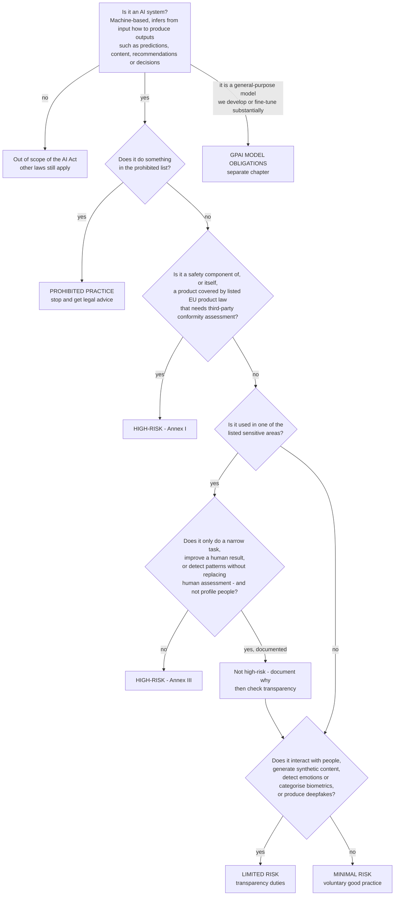

# EU AI Act quick classifier (plain language, not legal advice)

Use this to fill the *EU AI Act Category (preliminary)* column of the inventory in ten minutes per system, so that
legal counsel can confirm the ones that matter. The regulation is long and has exceptions; this page is a map, not the
territory. Check the current text and the dates that apply to you.

## Who does it apply to?

You are concerned if you **place AI systems on the EU market**, **put them into service in the EU**, or **their output is
used in the EU** — whether you are the **provider** (you develop it, or have it developed and market it under your name)
or the **deployer** (you use it under your authority in a professional context). Deployers have fewer obligations than
providers, but for high-risk systems they are real.

Note: a deployer who substantially modifies a high-risk system, puts their own name on it, or changes its intended
purpose into a high-risk one can become a provider.

## The decision tree

## Question by question

### 1. Is it an AI system at all?

Think "it infers". A system that works out from inputs how to produce predictions, content, recommendations or
decisions, with some autonomy, is in. A fixed set of rules written by a person is generally not, even if it is
complicated. If you are unsure, treat it as AI for inventory purposes; it costs nothing.

### 2. Prohibited practices

Some uses are banned outright. In plain words, the list targets systems that:

* manipulate people below their awareness or exploit vulnerabilities (age, disability, social situation) to cause harm;
* score people socially across contexts with detrimental effects;
* predict criminal behaviour of an individual purely from profiling or personality traits;
* scrape facial images from the internet or CCTV without targeting to build recognition databases;
* infer emotions in workplaces or schools (with narrow medical or safety exceptions);
* categorise people biometrically to deduce sensitive attributes such as race, political views or sexual orientation;
* perform real-time remote biometric identification in public spaces for law enforcement (narrow exceptions).

If a system touches any of these, stop and get legal advice before anything else.

### 3. High-risk — Annex I (product safety route)

If the AI is a safety component of a product already covered by EU product legislation that requires a third-party
conformity assessment (machinery, medical devices, vehicles, lifts, toys, aviation, and so on), or is itself such a
product, it is high-risk through that route.

### 4. High-risk — Annex III (sensitive areas)

The sensitive areas, in plain words:

| Area | Typical examples |
|------|------------------|
| Biometrics | Remote identification, categorisation by sensitive attributes, emotion recognition (where not prohibited) |
| Critical infrastructure | Safety components in the management of digital infrastructure, road traffic, water, gas, heating, electricity |
| Education and training | Admission decisions, grading, monitoring students during tests |
| **Employment and worker management** | **Recruitment screening and ranking, targeted job ads, promotion and termination decisions, task allocation and monitoring** |
| Essential services | Eligibility for public benefits, credit scoring, life and health insurance pricing, triage of emergency calls |
| Law enforcement | Risk assessment of individuals, evidence reliability, profiling |
| Migration, asylum, border | Risk assessment, application examination |
| Justice and democratic processes | Assisting judicial decisions, influencing elections |

A system in one of these areas is high-risk **unless** it only performs a narrow procedural task, improves the result
of a completed human activity, detects decision patterns without replacing human assessment, or is preparatory —
and does not profile people. If you rely on that exception, write the reasoning down (and in some cases register the
system).

The fictional candidate-screening system in the sample inventory (AIS-003) lands here: recruitment ranking is an
employment use, and ranking people is not a narrow procedural task.

### 5. Limited risk — transparency duties

Even if not high-risk, some systems carry transparency obligations:

* people must be told when they interact with an AI system (chatbots, voice assistants), unless obvious;
* synthetic audio, image, video or text must be marked as generated or manipulated in a machine-readable way;
* deepfakes must be disclosed as such;
* people must be informed when emotion recognition or biometric categorisation is applied to them.

The fictional support assistant (AIS-002) lands here.

### 6. Minimal risk

Everything else: spam filters, inventory forecasting, route optimisation, recommendation of products. No specific
obligations, but your own governance (this workbook) still applies — "minimal risk" under the Act does not mean
"no risk" to your business or to people. The fictional route optimiser (AIS-001) sits here, yet carries a High safety
risk in the register.

### 7. General-purpose AI models

If you develop (or substantially fine-tune) a general-purpose model, a separate set of obligations applies to the
model itself (documentation, copyright policy, information for downstream providers, more for models with systemic
risk). Most organisations are deployers of such models through an API and are not concerned by this chapter — but they
are concerned by whatever system they build on top.

## What each category means for you (deployer view)

| Category | What to do, in short |
|----------|----------------------|
| Prohibited | Do not use. Decommission if in use. Legal advice. |
| High-risk | Use according to the provider's instructions; ensure human oversight by trained people; keep the logs you control; inform workers' representatives and affected people where required; carry out the fundamental-rights impact assessment if you are a body that must; report serious incidents; cooperate with authorities. As provider: full obligations (risk management, data governance, documentation, logging, transparency, oversight, accuracy and robustness, conformity assessment, registration, post-market monitoring). |
| Limited risk | Implement the disclosure and marking duties. |
| Minimal | No Act-specific obligations; apply your AI policy and this register. |
| GPAI model | Only if you are the model provider. |

## Dates (verify against the current text)

The obligations phase in over time: prohibited practices and AI-literacy duties first, then general-purpose model
obligations, then most high-risk and transparency obligations, with the Annex I product-safety route last. Record in
the register (category "Legal & regulatory") which deadline applies to each system and who confirmed it.

## Record your classification

In `02_AI_System_Inventory`, pick the preliminary category. In `04_AI_Risk_Register`, add a "Legal & regulatory
(EU AI Act)" risk for every High-risk or Prohibited entry, and for Limited-risk systems where disclosure is not yet in
place. Ask counsel to confirm the High-risk and Prohibited ones; note the confirmation in the inventory's Notes column.
